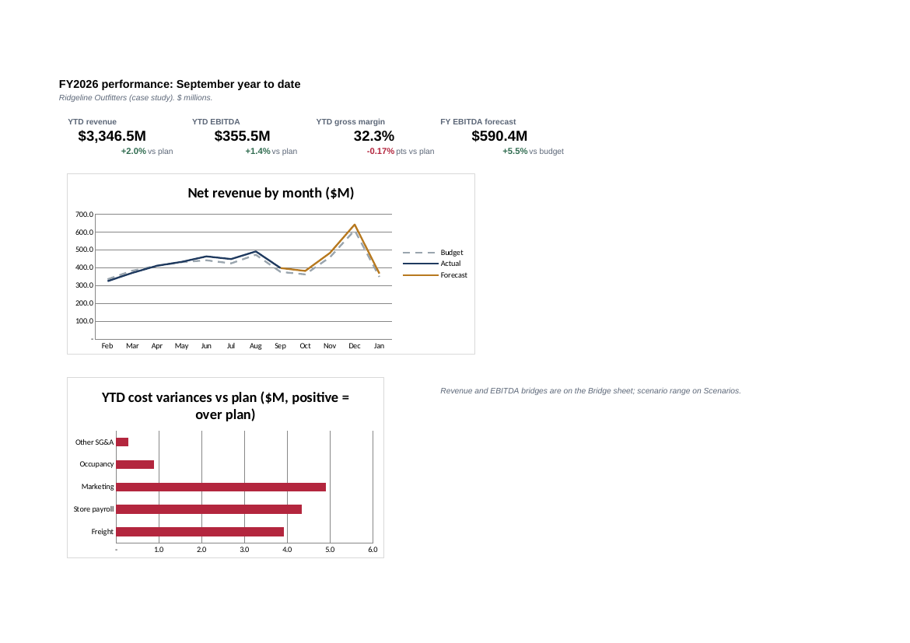
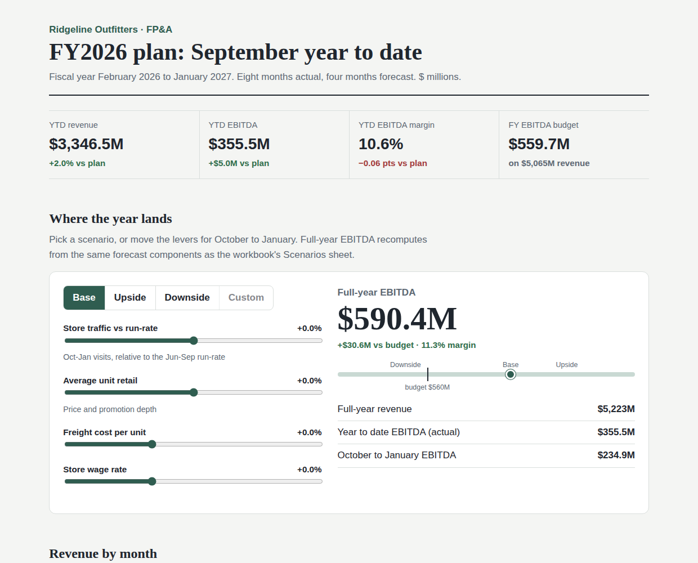
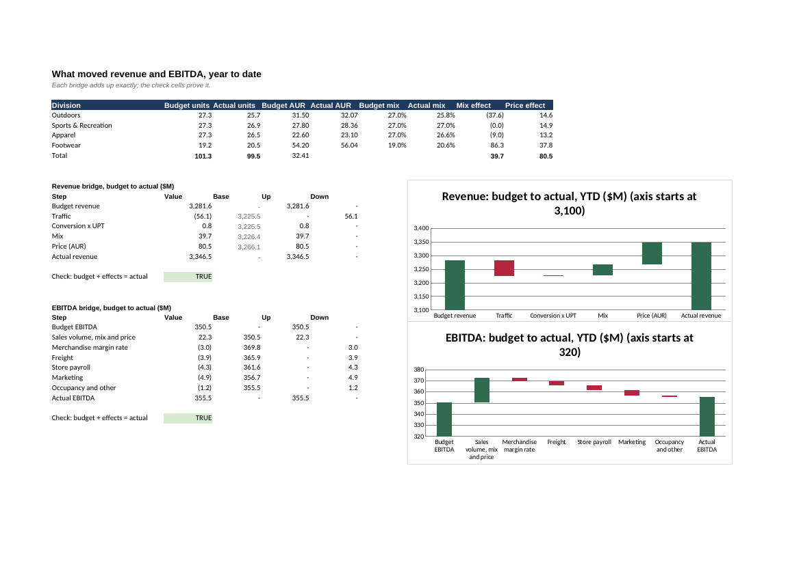
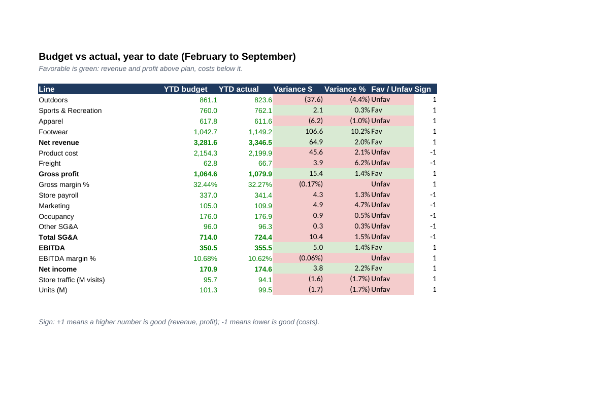

# FY2026 Operating Plan & Variance Pack

A full-year operating plan for a sporting goods retailer, built the way corporate FP&A teams build them:

- a driver-based budget
- eight months of actuals
- budget-versus-actual analysis with favorable/unfavorable logic
- price/volume/mix and EBITDA bridges that reconcile exactly
- an 8+4 rolling forecast with scenarios and a sensitivity grid
- an executive dashboard, and variance commentary that rewrites itself when the numbers change

The deliverable is an Excel workbook, [`output/FY2026_Operating_Plan.xlsx`](output/FY2026_Operating_Plan.xlsx), with 1,434 formulas and zero errors. A Power BI star schema with DAX measures sits alongside it.




## Web front end

The dashboard: KPIs, an interactive full-year outlook (scenarios and levers recompute EBITDA with the workbook's own arithmetic), monthly revenue, both bridges, the commentary and budget vs actual. It's a static page in `site/` that reads `site/data.json`, which is exported from the *calculated* workbook, so the page and the spreadsheet can't disagree. `tests/test_site.py` checks it.

**Live:** _deploying to Vercel; link to follow_



```bash
python -m fpa.site                       # refresh site/data.json from the calculated workbook
python -m http.server --directory site 8000
```

To host it, import the repo into Vercel with the root directory set to `site` (static, no build step).

## The company and the year

Ridgeline Outfitters is a fictional sporting goods chain with $5.1B of planned revenue across four merchandise divisions: Outdoors, Sports & Recreation, Apparel, and Footwear. The fiscal year runs **February 2026 to January 2027**, the usual retail calendar, so the year closes after the holidays and January clearance. Actuals are in through September, and October to January are forecast.

The plan's cost structure is calibrated to ratios typical of large US specialty retailers:

| | Plan, % of revenue |
|---|---|
| Gross margin | 32.4% |
| Store payroll | 10.1% |
| Marketing | 3.2% |
| Occupancy | 5.2% |
| EBITDA | 11.1% |

The first draft had store payroll at 15% of sales and an EBITDA margin under 1%. The formulas were right, but the assumptions weren't, and anyone in retail finance would have stopped reading there. A test now checks that the plan's ratios stay in a realistic range.

## What happened, in the pack's own words

The Commentary sheet builds each of these sentences from formulas. Change an actual, and the paragraph updates:

> Revenue was $3,346.5M, $64.9M (2.0%) above plan.
>
> Traffic cost $56.1M and conversion/basket added $0.8M, while price added $80.5M and mix toward higher-priced Footwear added $39.7M.
>
> Traffic ran 1.7% below plan, almost all of it in a cold, wet February-May; June-September ran +1.5% against plan.
>
> EBITDA was $355.5M, $5.0M above plan, at a 10.6% margin against 10.7% planned.
>
> Freight cost $3.9M more than plan as ocean rates spiked in May-July; September freight per unit was 1.00x plan.
>
> Store payroll was $4.3M over plan, mostly overtime in the July-August back-to-school ramp; marketing was $4.9M over, from the August campaign.
>
> The Base forecast lands full-year EBITDA at $590.4M, $30.6M above budget. The range across scenarios is $551.7M to $611.0M.

The headline hides two opposite stories. Revenue beat plan by 2.0% on price and mix, while traffic fell short. EBITDA beat by $5.0M, but **the margin slipped**, because freight, overtime, and marketing absorbed most of the price gains. Telling those two stories apart is what a variance pack is for.

## Bridges that add up



**Revenue (price / volume / mix).** Starting from budget revenue of $3,281.6M:

| Effect | Amount | How it's calculated |
|---|---|---|
| Traffic | $-56.1M | Change in store visits × budget units per visit × budget average price |
| Conversion × basket | $0.8M | The rest of the unit volume change, at budget average price |
| Mix | $39.7M | Shifting units between divisions at budget prices; here, toward higher-priced Footwear |
| Price | $80.5M | Actual units × (actual AUR − budget AUR), by division |

Together they reach actual revenue of $3,346.5M exactly. A check cell proves it.

**EBITDA.** Starting from budget EBITDA of $350.5M:

| Effect | Amount |
|---|---|
| Sales volume, mix and price at budget margin | $22.3M |
| Merchandise margin rate | $-3.0M |
| Freight | $-3.9M |
| Store payroll | $-4.3M |
| Marketing | $-4.9M |
| Occupancy and other | $-1.2M |

That lands at actual EBITDA of $355.5M, and again a check cell proves the bridge adds up.

The waterfall axes don't start at zero, because a $50M step on a $3.3B base would disappear. Each chart's title says where its axis starts.

## Budget vs actual



Every line shows year-to-date budget, actual, variance in dollars and percent, and favorable or unfavorable. A sign column handles the direction: higher revenue is good, higher cost is bad. That way the green and red always mean the same thing, whatever the line.

## Forecast and scenarios

The forecast is **8+4**: February to September link to actuals, and October to January run the budget drivers at run-rates measured from those actuals.

| Run-rate | Value | Why this window |
|---|---|---|
| Traffic vs plan | 1.015x | June to September only, because the cold spring was a one-off |
| Freight per unit vs plan | 1.000x | September, now that the ocean-rate spike has passed |
| Wage vs plan | 1.010x | September |
| AUR and unit mix | Year-to-date actual, by division | |

Each run-rate is a formula with its reasoning next to it, so anyone reviewing the forecast can disagree with a specific choice.

A selector on Assumptions switches the forecast between **Base**, **Upside**, and **Downside**, which multiply traffic, AUR, freight, and wages. The Scenarios sheet shows all three side by side, using the same forecast components:

| | Budget | Base | Upside | Downside |
|---|---|---|---|---|
| Full-year revenue | $5,064.8M | $5,223.3M | $5,298.9M | $5,093.1M |
| Full-year EBITDA | $559.7M | $590.4M | $611.0M | $551.7M |

Below that is a 7×7 sensitivity grid of full-year EBITDA by forecast-month traffic and AUR. Cells that miss the budget are shaded red.

## Building it in Excel the way it's built in practice

- **Inputs are blue,** formulas are black, cross-sheet links are green, and yellow fill marks the key assumptions. Every driver lives in one labeled cell on Assumptions, so nothing is typed into a formula.
- **Budget, Actuals, and Forecast share one row layout,** so the same line is the same row on every sheet, and the BvA and bridge formulas can't point at the wrong line.
- **Charts read from a visible Chart Data sheet.** The first version kept chart data in hidden columns, and the charts came out blank: Excel doesn't plot hidden cells by default.
- **Line charts use straight segments.** A smoothed curve invents values between months.
- **No XLOOKUP or dynamic arrays.** INDEX/MATCH, SUMIFS, and SUMPRODUCT work in every version of Excel a finance team might still be running.

## Power BI

`powerbi/` holds the same plan as a star schema: `fact_pnl` (month × line × division × version) with month, line, and division dimensions, exported from the recalculated workbook so both tools show identical numbers. It also has `measures.dax`, with Budget, Actual, Outlook (8+4), Variance, favorable variance, gross margin, EBITDA, and AUR. `powerbi/README.md` walks through building the report in about 20 minutes. The `.pbix` file itself isn't committed, because it can't be generated from code.

## Running it

```bash
pip install -r requirements.txt
python -m fpa build      # writes the workbook (formulas without cached results)
# open output/FY2026_Operating_Plan.xlsx in Excel and save it, so the formulas calculate
python -m fpa export     # writes the Power BI star schema from the calculated workbook
pytest -q
```

The repository ships the workbook already calculated, so the tests and the Power BI files work straight from a clone. The tests check that:

- the Excel budget matches an independent Python calculation
- the plan's ratios are realistic
- every bridge and consistency check reads TRUE
- price, volume, and mix add up to the revenue variance
- the scenarios are ordered sensibly
- the commentary is generated from the numbers
- the Power BI export matches the workbook

## What I'd add next

- **A 4-5-4 retail calendar,** with weeks rather than months, the way most retailers actually report, plus comparable-store sales.
- **A three-statement link:** inventory and payables from the purchase plan, so the forecast also produces cash flow.
- **Prior year as a third comparison,** next to budget and forecast.
